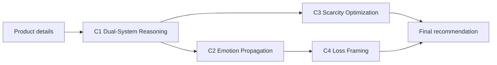
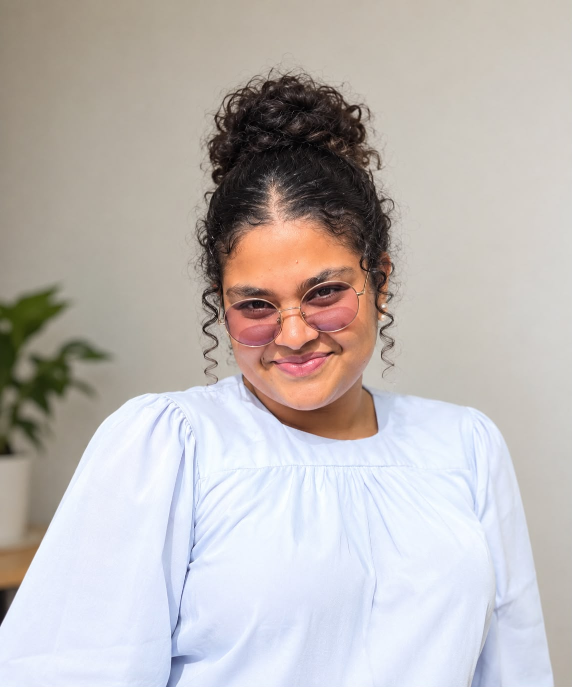

<div align="center">


# NEXTGEN AI — R26-DS-005

### An Agentic AI Framework for Neuro-Marketing Strategy Generation Based on Cognitive and Behavioural Principles

Final-year research project · BSc (Hons) in Information Technology, Specialising in Data Science<br>
Faculty of Computing · Sri Lanka Institute of Information Technology (SLIIT) · 2026

[](https://nextgen-ai-website.vercel.app/)
[](#)
[](#tech-stack)

**[🌐 Visit the website](https://nextgen-ai-website.vercel.app/)**

</div>

---

## 📖 About this repository

This repository holds the source code of the **academic information website** for our research project. The site records the full research journey, from topic assessment to the final viva: the research domain, the four research components, milestones, documents, presentations and the team.

> This website documents the research. The research product itself (the integrated AI system) is a separate codebase.

## 🎯 The research in brief

Small businesses and new online sellers need marketing content every day, but most cannot afford marketing experts. General AI writing tools produce fluent text, but they don't choose a psychological approach that suits the product, they don't check their own output, and they don't control how strongly they persuade.

**NEXTGEN AI** solves this by turning four well-studied principles of consumer psychology into four cooperating AI components. Together they turn a short product description into a complete, explainable and ethically bounded marketing strategy.

| # | Component | Behavioural theory | Lead |
|:-:|---|---|---|
| 01 | **Dual-System Reasoning Agent**: decides whether a product is bought on impulse or after careful thought | Dual Process Theory | Buwaneka Fernando<br><sub>fernandobuwaneka@gmail.com</sub> |
| 02 | **Emotion Propagation Agent**: writes copy that carries a target emotion and checks it with a classifier | Emotional Contagion | Savindi Pamodya<br><sub>savindipamodya@gmail.com</sub> |
| 03 | **Scarcity Optimization Agent**: adds believable urgency only where scarcity suits the product | Scarcity Principle | Buddima Senadeera<br><sub>Buddimasenadeera123@gmail.com</sub> |
| 04 | **Loss Framing Agent**: reframes messages around what the buyer may miss, with tone guardrails | Prospect Theory (Loss Aversion) | Praneepa Samaraweera<br><sub>praneepasamaraweera1000@gmail.com</sub> |

### How the components work together



### Key results

| Component | Result |
|---|---|
| C1 | ~91% decision-mode classification accuracy (RoBERTa), calibrated with temperature scaling |
| C2 | 8 target emotions across 7 product categories, with up to 3 validation-driven regeneration attempts |
| C3 | F1 0.71 (suitability) and 0.73 (pain points); human-rated purchase influence 4.1–4.2 / 5 (p = 0.031) |
| C4 | 87.5% framing accuracy (DistilBERT) and 88.7% tone safety compliance |

## 🗂️ Website pages

| Page | Content |
|---|---|
| **Home** | Project overview, research problem, components and integrated pipeline |
| **Research Domain** | Background, literature survey, research gap, problem, objectives, methodology, technologies |
| **Components** | Objective, research questions, pipeline, data, models, evaluation and results for each component |
| **Milestones** | Assessment timeline from topic approval to the final viva |
| **Documents** | Proposals, status documents, checklists, logbooks, theses and research paper |
| **Presentations** | Slides for each assessment stage |
| **About Us** | Supervisors, team members and contact form |

## <a id="tech-stack"></a>🛠️ Tech stack

**Website:** HTML5 · CSS3 · vanilla JavaScript. No framework or build step. Responsive layout, light and dark mode, hosted on Vercel.

**Research system (documented on the site):** Python · FastAPI · React + Vite · Hugging Face Transformers (RoBERTa, DistilBERT) · scikit-learn · LIME · VADER · Groq API (LLaMA 3.1 8B, gpt-oss-20b)

## 📁 Project structure

```
├── index.html            Home
├── research.html         Research Domain
├── components.html       Research Components
├── milestones.html       Milestones
├── documents.html        Documents
├── presentations.html    Presentations
├── about.html            About Us
├── css/style.css         Design, themes and responsive layout
├── js/data.js            ALL site content (edit this file)
├── js/main.js            Builds every page from data.js
└── assets/
    ├── img/              Logo and team photos
    ├── docs/             PDF documents (optional)
    └── slides/           Presentation files (optional)
```

## 🚀 Run locally

No installation is needed.

- Open `index.html` in any browser, **or**
- serve the folder with `python -m http.server 8080` and go to http://localhost:8080

## ✏️ Updating the site

All text, links, team details and results live in **`js/data.js`**. Edit that one file, commit it to `main`, and the live site redeploys automatically within about a minute.

- **Documents and slides:** set the `file` field to a Google Drive link or a path such as `assets/docs/file.pdf`.
- **Team photos:** put them in `assets/img/team/` and use the exact file names given in `data.js`. File names are case-sensitive.

## 👥 Team

<table>
  <tr>
    <td align="center" width="25%"><br><b>Buwaneka Fernando</b><br><sub>IT22250438</sub><br><sub>Component 01</sub></td>
    <td align="center" width="25%"><br><b>Savindi Pamodya</b><br><sub>IT22132482</sub><br><sub>Component 02</sub></td>
    <td align="center" width="25%"><br><b>Buddima Senadeera</b><br><sub>IT22640666</sub><br><sub>Component 03</sub></td>
    <td align="center" width="25%"><br><b>Praneepa Samaraweera</b><br><sub>IT22544704</sub><br><sub>Component 04</sub></td>
  </tr>
</table>

### Supervision

<table>
  <tr>
    <td align="center" width="50%"><br><b>Mr. Samadhi Rathnayake</b><br><sub>Supervisor · Faculty of Computing, SLIIT</sub></td>
    <td align="center" width="50%"><br><b>Ms. Adya Dissanayake</b><br><sub>Co-Supervisor · Faculty of Computing, SLIIT</sub></td>
  </tr>
</table>

## 📬 Contact

📧 **nextgenresearch4@gmail.com**

---

<div align="center">
<sub>© 2026 NEXTGEN AI · R26-DS-005 · Sri Lanka Institute of Information Technology. Developed for academic purposes.</sub>
</div>